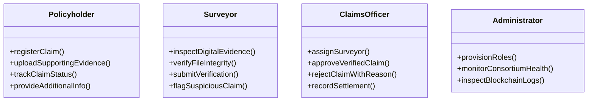

# InsureChain: Blockchain-Based Insurance Claim Management and Verification System
**A Formal Academic Case Study & Engineering Report**  
*Course: Blockchain Technology (BCT) — Academic Year 2026*  

---

## 1. Abstract
The conventional insurance claim management lifecycle is fundamentally constrained by centralized database architectures, opacity, administrative delays, and unilateral record control by underwriting institutions. These vulnerabilities expose both claimants and insurers to friction, asymmetric information, and risks of post-submission tampering. This report presents **InsureChain**, a hybrid decentralized application (dApp) that leverages Ethereum Virtual Machine (EVM) smart contracts, deterministic state machine enforcement, Role-Based Access Control (RBAC), and dual-layer cryptographic document hashing (Keccak-256 and SHA-256) to guarantee immutable chronology, non-repudiation, and tamper-evident auditability across the entire insurance lifecycle. By partitioning sensitive Personally Identifiable Information (PII) and large evidence binaries into an off-chain storage layer while anchoring state transitions and document hashes on-chain, InsureChain achieves legal privacy compliance (GDPR/HIPAA compatibility) while maintaining decentralized integrity. Comprehensive testing—comprising 19 automated smart contract unit tests, cryptographic hash collision and tampering simulations, and full-lifecycle end-to-end integration—empirically validates that unauthorized state transitions and document modifications are strictly blocked.

---

## 2. Introduction
The global insurance industry processes trillions of dollars in claims annually. The workflow connecting incident occurrence, policyholder submission, third-party loss assessment, insurer adjudication, and final financial settlement requires high degrees of inter-organizational trust. However, legacy enterprise platforms rely on centralized relational databases where database administrators possess root access to alter timestamps, erase audit logs, or manipulate evidence records.

Blockchain technology offers an alternative paradigm rooted in distributed consensus, verifiable computation, and cryptographically signed transactions. By embedding business logic directly into immutable Solidity smart contracts, InsureChain creates an environment where insurance lifecycle rules are enforced deterministically by mathematical code rather than institutional goodwill.

---

## 3. Problem Statement
Contemporary insurance claims processing suffers from three major structural pathologies:
1. **Asymmetric Information and Operational Opacity:** Claimants have limited visibility into review progress, leading to disputes over processing delays.
2. **Vulnerability to Unauthorized Record Modification:** In centralized databases, records of submitted invoices, medical discharge certificates, and damage photographs can be silently overwritten, corrupted, or backdated.
3. **Absence of Shared Multi-Party Provenance:** Insurers, independent loss adjusters (surveyors), and policyholders operate in siloed informational domains, preventing objective, non-repudiable audit trails during regulatory scrutiny or legal arbitration.

---

## 4. Project Objectives
The primary objectives of the InsureChain system are:
1. **Deterministic Lifecycle Modeling:** Implement a strict, non-reversible state machine governing transitions from `SUBMITTED` to `SETTLED` on an EVM smart contract.
2. **Smart-Contract RBAC:** Enforce cryptographic role authorization ensuring that only designated actors (Policyholders, Certified Surveyors, Claims Officers, Administrators) can execute privileged functions.
3. **Tamper-Evident Evidence Integrity:** Anchor cryptographic hashes (SHA-256 and Keccak-256) of uploaded evidence documents on-chain to detect file alteration.
4. **Privacy-Preserving Off-Chain Storage:** Ensure that sensitive customer PII and heavy media files are kept off the public ledger, recording only anonymized hashes on-chain.
5. **Verifiable Decision Certification:** Produce cryptographically verifiable decision summaries certifying the chronology and integrity of all recorded lifecycle events.

---

## 5. Existing Insurance Claim Management Systems and Limitations
| Feature | Traditional Centralized Systems | InsureChain Decentralized Architecture |
|---|---|---|
| **Storage Architecture** | Centralized Relational DB (SQL/Oracle) | Hybrid: Off-Chain Document Store + On-Chain State Machine |
| **Audit Log Integrity** | Modifiable by root database administrators | Cryptographically immutable, distributed block logs |
| **State Transition Logic** | Procedural application code (easily bypassed) | Enforced by EVM smart contract bytecode |
| **Evidence Verification** | Manual visual inspection of files | Cryptographic hash recalculation against immutable ledger |
| **Actor Accountability** | Session-based username/password | Cryptographic digital signatures (Private/Public Key pairs) |
| **Inter-Organizational Trust**| Unilateral trust in the insurer | Trust-minimized consensus between multi-party consortium |

---

## 6. Motivation for Using Blockchain
Blockchain provides:
- **Immutability:** Transaction history and status transitions are sealed into cryptographically linked blocks, preventing retroactive manipulation.
- **Non-Repudiation:** Actions must be signed by the private key corresponding to the authorized Ethereum address; actors cannot later deny submitting reports or making decisions.
- **Programmable Compliance:** Smart contract modifiers (`onlyRole`, `claimExists`) reject invalid operations at the execution layer, eliminating human error or illicit shortcuts.

---

## 7. Proposed System
InsureChain implements a modular architecture composed of:
1. **Solidity Smart Contract (`InsuranceClaimManager.sol`):** Deployed on an EVM network, maintaining claim structs, role bindings, lifecycle state, and event emissions.
2. **Backend Application Service (Node.js/Express):** Manages secure document uploads, dual-hash generation, JWT session authentication, and Ethereum JSON-RPC synchronization.
3. **Off-Chain Data Store (MongoDB & Storage):** Retains private document files, metadata descriptions, and user credentials.
4. **Responsive Frontend Client (React + Vite):** Role-specific workspaces tailored for Policyholders, Surveyors, Claims Officers, and Administrators.

---

## 8. Functional and Non-Functional Requirements

### Functional Requirements
- **FR-1 Claim Registration:** Policyholder registers claim with policy reference, category, requested amount, and evidence bundle hash.
- **FR-2 Surveyor Assignment:** Claims Officer assigns an authorized surveyor address to a submitted claim.
- **FR-3 Evidence Integrity Verification:** System recalculates file hashes from disk and compares them against on-chain records.
- **FR-4 Verification Submission:** Surveyor records inspection findings, recommended claim amount, and verification report hash.
- **FR-5 Discrepancy Flagging:** Authorized actors flag suspicious claims, preventing premature approval.
- **FR-6 Adjudication Decision:** Claims Officer approves or rejects verified claims with immutable justification.
- **FR-7 Settlement Recording:** Claims Officer records financial disbursement references upon approved claims.

### Non-Functional Requirements
- **NFR-1 Security:** Role-based access control enforced on-chain; passwords hashed with bcrypt (salt rounds = 10).
- **NFR-2 Performance & Latency:** Local Hardhat node block generation < 1 second; API response times < 200ms.
- **NFR-3 Privacy (GDPR):** Zero plaintext personal identifiers committed to public blockchain state.
- **NFR-4 Usability:** Responsive UI with real-time transaction indicators, stepper visualizers, and printable certificates.

---

## 9. User Roles and Permissions



---

## 10. System Architecture Diagram
*(Refer to `documentation/ARCHITECTURE.md` for high-resolution interactive Mermaid diagrams).*

---

## 11. Claim Lifecycle Flowchart
The claim progresses through a deterministic finite-state automaton:
$$\text{SUBMITTED} \xrightarrow{\text{Assign Surveyor}} \text{UNDER\_REVIEW} \xrightarrow{\text{Verify Findings}} \text{VERIFIED} \xrightarrow{\text{Officer Decision}} \text{APPROVED} \xrightarrow{\text{Disbursement}} \text{SETTLED}$$
Secondary authorized branches:
- $\text{UNDER\_REVIEW} \xrightarrow{\text{Discrepancy}} \text{FLAGGED} \xrightarrow{\text{Re-inspection}} \text{UNDER\_REVIEW}$
- $\text{UNDER\_REVIEW} \xrightarrow{\text{Info Needed}} \text{ADDITIONAL\_INFO\_REQUIRED} \xrightarrow{\text{Doc Upload}} \text{UNDER\_REVIEW}$
- $\text{VERIFIED / FLAGGED} \xrightarrow{\text{Exclusion Clause}} \text{REJECTED}$

---

## 12. Smart-Contract Design and Explanation
The contract `InsuranceClaimManager.sol` inherits from OpenZeppelin's `AccessControl`:
```solidity
enum ClaimStatus {
    SUBMITTED,               // 0
    UNDER_REVIEW,            // 1
    VERIFIED,                // 2
    APPROVED,                // 3
    SETTLED,                 // 4
    FLAGGED,                 // 5
    REJECTED,                // 6
    ADDITIONAL_INFO_REQUIRED // 7
}
```
State integrity is safeguarded through custom errors:
- `ClaimAlreadyExists(bytes32 claimId)`
- `ClaimDoesNotExist(bytes32 claimId)`
- `UnauthorizedCaller(address caller)`
- `InvalidStateTransition(ClaimStatus currentStatus, ClaimStatus targetStatus)`
- `ClaimNotVerified()`

---

## 13. Blockchain Transaction and Event Handling
Every state change emits an indexed event into the transaction receipt log:
- `ClaimRegistered(bytes32 indexed claimId, string claimReference, address indexed claimant, uint256 requestedAmount, bytes32 documentRootHash, uint256 timestamp)`
- `SurveyorAssigned(bytes32 indexed claimId, address indexed surveyor, address indexed assignedBy, uint256 timestamp)`
- `VerificationSubmitted(bytes32 indexed claimId, address indexed surveyor, uint256 recommendedAmount, bytes32 surveyorReportHash, bool isVerified, uint256 timestamp)`
- `ClaimApproved(bytes32 indexed claimId, address indexed claimsOfficer, uint256 approvedAmount, string decisionReference, uint256 timestamp)`
- `SettlementRecorded(bytes32 indexed claimId, address indexed claimsOfficer, uint256 amount, string settlementReference, uint256 timestamp)`

These event logs allow clients to reconstruct the complete historical audit trail directly from block receipts without querying external databases.

---

## 14. Implementation Details
- **Smart Contract:** Solidity v0.8.24 compiled using Hardhat optimizer (200 runs), targeting EVM Paris.
- **Backend:** Node.js v22 with Express REST APIs, Multer multipart storage, and Ethers.js v6.
- **Off-Chain Storage:** MongoDB schema models with seamless in-memory fallback for environment-independent testing.
- **Frontend:** React 18, Vite 5, Lucide-react iconography, and responsive custom CSS.

---

## 15. Security and Privacy Considerations
1. **Privacy Separation:** Plaintext names, phone numbers, and diagnostic notes are kept off-chain. Only cryptographic hashes of policy references and evidence bundles are committed to the public ledger.
2. **Reentrancy and Access Guards:** All mutating functions feature caller authorization checks (`onlyRole`) and state assertions before state mutation.
3. **Integer Precision:** Monetary amounts are handled using 18-decimal fixed-point integers (Wei) to eliminate floating-point rounding errors.

---

## 16. Testing Methodology and Actual Results

### A. Smart Contract Unit Tests (Hardhat / Mocha / Chai)
**Test Suite:** `blockchain/test/InsuranceClaimManager.test.js`  
**Result:** **19 Passing Tests (0 Failures, 2s execution)**
1. Deployer receives `DEFAULT_ADMIN_ROLE` (Pass)
2. Roles correctly granted to Surveyor and Insurer (Pass)
3. Unauthorized role assignment prevented (Pass)
4. Valid claim registration with document hash (Pass)
5. Duplicate claim reference rejection (Pass)
6. Zero amount and invalid document hash rejection (Pass)
7. Surveyor assignment moves claim to `UNDER_REVIEW` (Pass)
8. Unauthorized surveyor assignment rejected (Pass)
9. Assigning non-surveyor address rejected (Pass)
10. Surveyor positive verification moves claim to `VERIFIED` (Pass)
11. Negative surveyor verification flags claim (Pass)
12. Non-surveyor verification attempt blocked (Pass)
13. Request and provide additional info loop (Pass)
14. Flagging and unflagging by insurer (Pass)
15. **Premature approval prior to verification blocked with custom error** (Pass)
16. Valid claim approval by claims officer (Pass)
17. Claim rejection with recorded justification (Pass)
18. **Premature settlement before approval blocked with custom error** (Pass)
19. Successful settlement recording after approval (Pass)

### B. Cryptographic Hash & Tampering Tests
**Test Suite:** `backend/tests/api.test.js`  
**Result:** **4 Passing Tests (0 Failures)**
1. SHA-256 and Keccak-256 hash generation verified (Pass)
2. Untouched file integrity verified with 100% hash parity (Pass)
3. **Malicious file byte tampering instantly detected and flagged** (Pass)
4. Evidence bundle root hash calculation verified (Pass)

### C. End-to-End Blockchain Lifecycle Test
**Test Suite:** `backend/tests/e2e-workflow.test.js`  
**Result:** **All 7 Lifecycle Steps Successfully Completed & Verified On-Chain**

---

## 17. Advantages and Expected Benefits
- **Zero Retroactive Alteration:** Submitted evidence cannot be modified without immediate cryptographic detection.
- **Deterministic Process Compliance:** Claims officers cannot bypass surveyor verification.
- **Transparent Accountability:** Multi-party consortium shares a synchronized state.
- **Audit Efficiency:** Printable decision certificates provide instant mathematical proof of chronological validity.

---

## 18. Limitations
1. **The Oracle / GIGO Limitation:** A valid cryptographic document hash proves only that the digital file has remained unchanged since submission; it cannot independently prove that the real-world accident or medical incident occurred.
2. **Surveyor Integrity:** Blockchain records who submitted the report and when, but does not guarantee that human surveyors are immune to collusion or honest mistakes.
3. **Settlement Distinction:** Recording a settlement on the blockchain updates the authoritative accounting ledger; it is not an actual fiat wire transfer through commercial banking rails.

---

## 19. Future Enhancements
- Integration with Decentralized Identity (W3C DID / Verifiable Credentials) for certified surveyor credentials.
- Chainlink oracle integration to verify police report databases or meteorological catastrophe feeds.
- Automated parametric smart contract settlement for flight delay or flood insurance.

---

## 20. UN Sustainable Development Goals (SDG) Mapping
- **SDG 9: Industry, Innovation, and Infrastructure:** Modernizes the financial infrastructure with resilient, open, and tamper-evident decentralized technology.
- **SDG 16: Peace, Justice, and Strong Institutions:** Promotes institutional transparency, reduces bureaucratic fraud, and establishes non-repudiable accountability in institutional claims processing.

---

## 21. References
1. Nakamoto, S. (2008). *Bitcoin: A Peer-to-Peer Electronic Cash System.*
2. Wood, G. (2014). *Ethereum: A Secure Decentralised Generalised Transaction Ledger.*
3. OpenZeppelin Contracts. (2024). *AccessControl.sol Specification and Security Patterns.*
4. National Institute of Standards and Technology (NIST). (2015). *FIPS PUB 180-4: Secure Hash Standard (SHS).*
5. United Nations. (2015). *Transforming our World: The 2030 Agenda for Sustainable Development (SDGs 9 and 16).*

---

## 22. Application Screenshots (Demonstration Interface)
*(Note: Visual components are rendered interactively in the web frontend running on `http://localhost:3000`).*

1. **Figure 1: Policyholder Claim Registration Interface**  
   *Interactive form capturing policy reference, loss narrative, and multi-file drag-and-drop evidence uploader with real-time SHA-256 hash previews.*
2. **Figure 2: Surveyor Inspection Workspace & Hash Verifier**  
   *Inspection queue featuring one-click cryptographic integrity verification that recalculates file hashes on disk to detect file modification.*
3. **Figure 3: Claims Officer Adjudication Panel**  
   *Review controls allowing approved amount recording, policy exclusion rejection reasons, and settlement synchronization.*
4. **Figure 4: Official Tamper-Evident Claim Decision Certificate**  
   *Printable certificate displaying on-chain transaction hashes, block heights, evidence root hashes, and academic disclaimers.*
