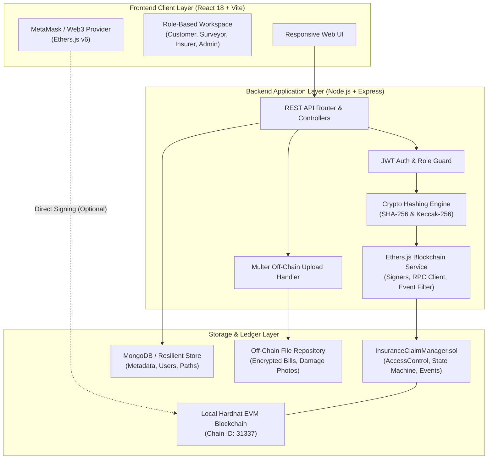
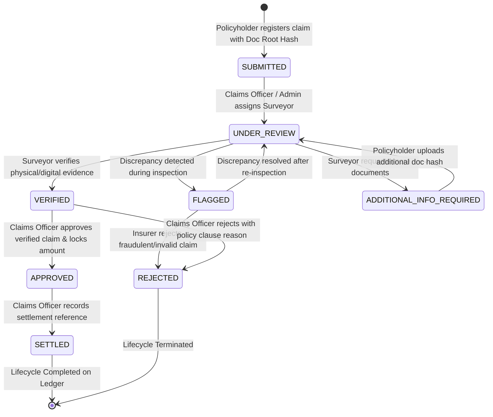
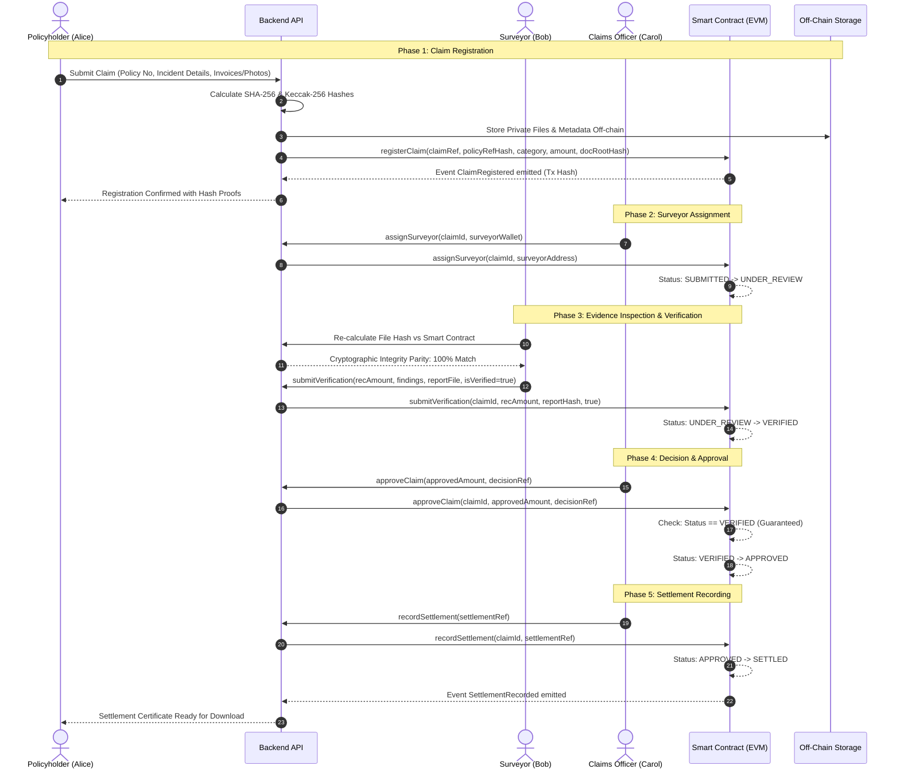

# InsureChain System Architecture & Engineering Specification

## 1. High-Level Architecture Overview

InsureChain implements a layered, privacy-preserving hybrid decentralized application (dApp) architecture. The blockchain provides an immutable, tamper-evident ledger for claim states, role authorizations, and cryptographic document hashes, while an off-chain storage layer safeguards private documents and user credentials.

---

## 2. Claim Lifecycle State Machine

The smart contract implements a non-reversible, deterministic state machine with strict role checks at every transition:

---

## 3. Sequence Workflow: End-to-End Claim Execution

